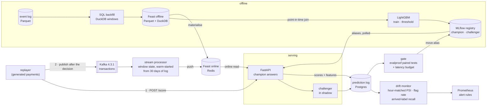

# realtime-ml

[](https://github.com/technobasant/realtime-ml/actions/workflows/ci.yml)
[](LICENSE)


**A real-time fraud model whose leakage, skew and label delay are measured, not just
avoided.** Payments for Lumen & Loom, an online homewares retailer (a standard
e-commerce scenario), flow through Kafka into a stream processor that keeps window
features in Feast's online store. A FastAPI
service scores each payment with the champion model and the challenger in shadow and logs
both; a gate promotes the challenger only on a statistically significant, paired
improvement. A monitor watches for drift and Prometheus alerts on it.

Most of the ways a model like this fails happen before it is served: a training join that
reads the future, a backfill that computes a feature differently from the stream, labels
that arrive weeks after the transaction, a monitor that cries wolf every evening. Each of
those is built here on purpose, next to the correct version, and the difference is
measured on reproducible generated data with injected fraud patterns and a drift switch.

## What the runs showed

All figures come from [MEASUREMENTS.md](MEASUREMENTS.md), which has the method, the seeds,
the environment and every table.

| Question | Measured |
|---|---|
| What does a naive training join cost? | It **looks better and is far worse**: validation AUC-PR 0.746 against 0.681 for the point-in-time join, then **0.363 against 0.941** on the following two weeks. 100% of its training rows took customer features from after the transaction |
| What do late chargebacks do? | Training on everything with the labels known on the day ruins the threshold, not the ranking: AUC-PR 0.930, but recall 0.81 and 11.8 points of cost saving lost against training on rows matured 14 days. A week after a day's traffic only 52% of its frauds are known; 11% never will be |
| How good is the model? | On two unseen weeks: AUC-PR 0.941, recall 0.954 at precision 0.668 flagging 1.2% of payments, **82.5% of fraud cost saved** (a hand-written rule: 20.7%). Brier 0.0018 — but **under-confident in its top 1%** (a score of 0.42 is fraud 67% of the time): it learned P(chargeback), not P(fraud) |
| Do the two feature implementations agree? | SQL backfill and stream state machine: **100% of 68,273 rows identical**. A planted defect changed 16.8% of one feature and was caught — and left AUC-PR unchanged, so a model-level check would have passed it |
| Do served features match training? | **99.905% of 9,500 live requests** served exactly the point-in-time features; card-testing rows 94.4%, because a day replayed in seven minutes puts burst attempts closer together than the stream's lag |
| How fast is scoring? | Feature fetch plus model, inside the API: **p50 0.54–0.73 ms, p99 3.5–4.3 ms** at 25, 50 and 100 requests/s, 0 errors in 9,500. Seen by the client: p99 34–257 ms, a tail not yet explained |
| Does the gate promote the right model? | Offline, 68,016 paired shadow transactions: v2 saves **$0.109 per transaction** (95% CI 0.085–0.137, p < 0.001) and is promoted; a reseeded copy (p = 0.35), an underfit model and an oversized one that only beats the weaker champion are refused. Live: v2 promoted at **$0.137** (0.075–0.210, p < 0.001) and served 6.1 s later; its reseeded twin refused |
| Does drift monitoring work? | **Not well, and that is the finding.** When fraudsters went quiet (recall −3 to −9 points), feature and score PSI never fired on the real change; flag rate at \|z\| > 4 caught 5/5 in a median 48 h with **17% false alarms**; recall on arrived chargebacks caught 3/5, about 300 h late. Live, a 50% price rise fired the alert 49 s after the first drifted payment |

Each failure here changed the design; the [failure log](#failure-log) lists what and where.

## Architecture



## Quick start

Needs Docker with about 8 CPUs and 12 GB, `make`, and [uv](https://docs.astral.sh/uv/)
for the offline experiments.

```bash
make up          # build; Kafka, Redis, Postgres, MLflow, Prometheus; data; online store
make train       # v1 → champion, v2 → challenger, in MLflow
make serve       # API on :8800, stream processor, drift monitor
make demo        # replay, latency, parity, gate + promote, drift alert, refuse: ~12 min
make down        # everything, volumes included

make experiments # the offline measurements, no containers: ~10 min
make check       # ruff, mypy --strict, pytest
```

Score one payment by hand:

```bash
curl -s localhost:8800/score -H 'content-type: application/json' -d '{
  "txn_id": "t_demo", "ts": "2026-09-16T10:00:00+00:00", "customer_id": "c_10",
  "card_id": "k_10_0", "device_id": "d_10_0", "merchant_category": "grocery",
  "amount": 42.5, "country": "US"}'
```

MLflow is on :5050, Prometheus (alerts under `/alerts`) on :9095.

## Decisions

| Decision | Why | ADR |
|---|---|---|
| Feast: DuckDB over Parquet offline, Redis online, applied from code | Real PIT joins and materialisation, light enough for one VM; each environment registers its own paths | [1](docs/adr/0001-feast-duckdb-redis.md) |
| Every window feature written twice — SQL and stream — with a parity test | One shared function hides skew instead of testing for it | [2](docs/adr/0002-two-implementations-of-each-feature.md) |
| Score with the state after the previous event; `ttl=0` | The same "as of" online and offline; Feast applies a view's TTL offline but not on Redis reads | [3](docs/adr/0003-window-semantics.md) |
| Train on rows at least 14 days old, with the labels known on the day | Immature labels ruin the threshold; waiting 30 days throws away half the data for nothing | [4](docs/adr/0004-label-maturity.md) |
| Promote only on a significant paired improvement within 2 ms p99 | Shadow traffic is paired; "the higher number wins" promotes noise | [5](docs/adr/0005-promotion-gate.md) |
| Kafka 4.3.1 in KRaft mode, one broker | The log's guarantees are not what is under test here | [6](docs/adr/0006-kafka-kraft.md) |
| Drift: fixed reference, count window, hour-matched PSI, calendar features excluded | The textbook recipe fired on calendars and evenings, not on drift | [7](docs/adr/0007-drift-monitoring.md) |

## Failure log

What went wrong while building this, and what changed because of it.

* **The first generator was too easy.** Fraud never overlapped legitimate behaviour, and
  v2 scored AUC-PR 1.0. Legitimate customers now buy big-ticket items, switch devices and
  travel; fraudsters rotate devices and use the victim's own.
* **Ties at the same timestamp.** Clipping purchase times to the day put thousands of
  purchases at 23:59:56. A SQL `RANGE` window counts ties together and a stream counts them
  in arrival order, so 0.06% of rows disagreed. Timestamps are now unique to the
  microsecond, and the gap is documented (ADR 2).
* **Fraud volume did not scale with customers**, so the small test datasets were 3% fraud.
* **The latency tail was the thread pool.** First live run: 4 ms median, 85 ms p99 at 25
  requests/s. Overlapping requests fought over the GIL, building a one-row DataFrame cost
  more than the model, and LightGBM used four OpenMP threads per prediction. The endpoint
  is now async and inline, request features are built from a dict (a test holds them equal
  to the training transform on every row), prediction uses one thread, and the challenger
  runs on its own thread.
* **The gate refused the better model for the wrong reason.** Its latency check read the
  shadow log, where v2's p99 was 3.9 ms for a 0.16 ms median — contention in the API
  process, not the model; the champion's own p99 on the same server was 2.5 ms. The gate
  now benchmarks the challenger on the serving path. A few hundred calls then proved too
  noisy (2.8 ms p99 for a 0.04 ms model), so it times 3,000 with the collector paused.
* **The load generator was in the measurement.** Publishing to Kafka from the replay's
  event loop put up to a second into client-side latency (p99 826 ms against 57 ms without
  it) while the server's timings stayed flat. The producer now has its own thread.
* **The drift alert fired before the drift, twice.** A 3,000-transaction window is seven
  hours of traffic, and hour-of-day PSI against the whole-day reference was 5.1. Excluding
  hour of day moved the false alarm to time since the last purchase (PSI 0.71), which has a
  daily cycle too. PSI is now computed against the reference re-weighted to the window's
  hours, which removes the cycle from every feature at once.
* **MLflow 3.17's server wants psycopg 3** for a `postgresql://` URL; the image installs it.

## Limits

* **Generated data.** The absolute scores describe the generator. The comparisons —
  naive against PIT, mature against immature labels, one monitor against another — are the
  findings; the 0.94 is not.
* **One host.** Every container shares one VM, so the latency figures contain no network
  hops, and the load generator competes with the system for CPU.
* **Client-side latency tails are not fully explained.** Inside the API, p99 stays under
  5 ms; the client sees stalls of up to 0.7 s that the server's own timer does not. The
  Kafka producer was one cause; at least one more remains between the two timers.
* **End-to-end parity is measured at replay speed.** Seven minutes per day puts a
  card-testing burst's attempts closer together than the stream's lag; at real speed far
  fewer rows would disagree, and that has not been measured.
* **The drift monitors do not catch a tactics change both quickly and quietly** (above).
* **No window is re-expired at read time**; the model is told how stale it is instead
  (ADR 3).
* **One Kafka partition.** Scaling the processor out needs a partitioning scheme that keeps
  customer, device and customer-device state together; it does not exist yet.
* **The latency rule is exercised by unit tests only**: no challenger here breached 2 ms on
  the serving path.
* **No authentication on the API**, and the prediction log stores raw features.

## Roadmap

* Re-expire windows at read time, in the SQL backfill and the API alike, and measure what
  it changes.
* Monitor the flagged slice rather than the whole population, and recalibrate on matured
  labels.
* Partition by customer, with device state in a second keyed stream; then several
  processor instances.
* Find the remaining client-side stalls; measure parity at real speed.
* A Grafana board over the Prometheus metrics.

## Repository layout

```
src/rtml/
  generate.py          generated payments (fixed seed), fraud patterns, late labels, drift switch
  features/            defs.py (contract + request transform), batch.py (SQL),
                       online.py (stream state), naive.py (the leaky join)
  store.py             the Feast repository, in code
  dataset.py           build, PIT join, naive join, labels as of a date
  train.py             LightGBM, threshold, MLflow registry
  gate.py              paired comparison with evalproof, latency benchmark
  serve/               app.py (API), models.py, predlog.py, replay.py, live.py, bootstrap.py
  stream/processor.py  Kafka → window state → Feast push
  monitor/             drift.py (PSI, KS, flag-rate z), service.py (Prometheus exporter)
  experiments/         offline.py, drift_eval.py
  demo.py              the live run behind `make demo`
docs/adr/              seven decisions
ops/                   Prometheus config and alert rules, Postgres init
results/               the JSON every number in MEASUREMENTS.md comes from
```

## Licence

Apache-2.0. See [LICENSE](LICENSE) and [NOTICE](NOTICE).
